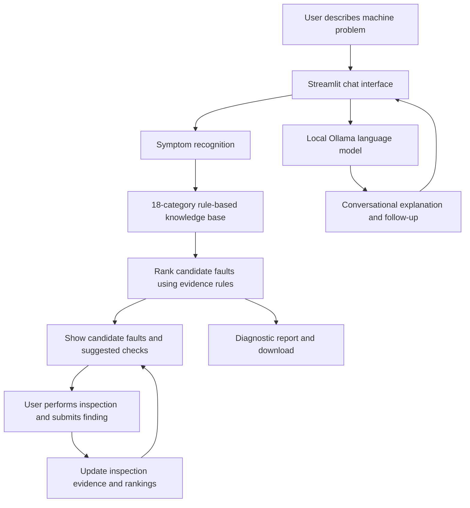

# Development Schema — Failure Detective AI

## Main components
- **Interface:** Streamlit chat and diagnostic workspace.
- **Language model:** Ollama running locally; no hosted paid API is required.
- **Knowledge base:** 18 defined mechanical failure categories with symptoms and checks.
- **Reasoning engine:** rule-based scoring and candidate ranking.
- **Feedback loop:** user-provided inspection findings update the assessment.
- **Output:** chat responses, ranked candidates, inspection guidance, and downloadable report.

## Agent cycle
**Observe → Interpret → Rank → Recommend a check → Receive inspection evidence → Reassess → Report.**
